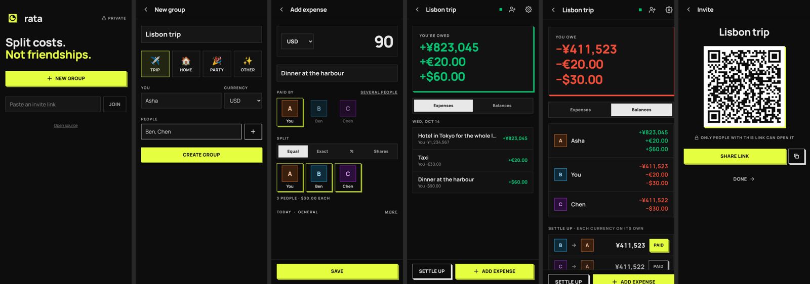

# Rata design language

Rata is dark, direct and tactile. The design borrows ideas from **NeoPOP**, the open-source design system from CRED (Apache-2.0, [github.com/CRED-CLUB/neopop-web](https://github.com/CRED-CLUB/neopop-web)): black surfaces, strong type, hard square edges, and 3D "pop" buttons that move down when you press them.

We use the ideas and the open palette only. We do not use the CRED name, logo, illustrations or proprietary fonts. Rata has its own accent colour and its own font.

## Tokens

All tokens are in [`apps/web/src/index.css`](../apps/web/src/index.css) (`@theme`). Use only these tokens. Do not write a hex value or a Tailwind palette colour (for example `stone-500`) in a component.

| Token | Value | Use |
|---|---|---|
| `ink` | `#0d0d0d` | Page background |
| `panel` | `#121212` | Card |
| `raised` | `#161616` | Field, tab track, row hover |
| `line` | white 10% | Card border, dividers |
| `line-strong` | `#3d3d3d` | Field border, edge of a neutral pop |
| `fg` / `fg-2` / `muted` / `faint` | white 90 / 70 / 50 / 30% | Heading / body / label / hint |
| `accent` | `#e5fe40` | The **one** main action on a screen. Selection. |
| `accent-edge` | `#a0b22d` | 3D edge of an accent button |
| `owed` | `#06c270` | Money comes back to you |
| `owes` | `#ee4d37` | You owe money. Delete. Errors. |
| `warn` | `#f08d32` | Syncing, warnings |

Font: **Manrope** (variable, SIL Open Font License), self-hosted. Weights: 800 for headings, buttons and labels; 700 for list titles; 400–500 for body.

## Rules

1. **Square edges.** No rounded corners on cards, fields, buttons or avatars.
2. **One accent action per screen.** It uses `btn-primary`. Other actions use `btn-secondary` (white outline pop) or `btn-ghost` (text only).
3. **Pop for actions only.** A pop edge means "you can press this". Do not put a pop edge on a card or a static item.
4. **Labels are caps.** Field labels, section titles and small meta text use `caps` (11 px, 800, wide tracking, `muted`).
5. **Money is big and bold.** A balance uses 800 weight and tabular numbers (`num`). Green and red show only the direction of money, not decoration.
6. **Dark only.** No light theme. Contrast of body text on `ink` is at least 4.5:1.
7. **Motion is short.** 120 ms ease-in-out for the press. No bounce, no long fades.
8. **Text in ASD-STE100.** Short sentences, active voice, one meaning for each word.
9. **Minimal text.** Labels have 1 to 3 words. No paragraphs that explain how the app works; a lock icon with "Private" says it. If a control needs a sentence of help, change the control.
10. **Tap people, do not pick them from a list.** Use `<PeoplePicker>` for payer, split and settle. Use a `<select>` only for long lists such as currencies.
11. **Amount first.** On money screens the amount is the biggest thing (`amount`). The main action sits in a sticky bottom bar.
12. **Signs, not only colour.** Amounts that show direction have `+` or `−` as well as green or red.
13. **Colours by position.** `<Avatar i={index}>` takes its colour from the person's place in the group, so two people in one group never share a colour.

## Components

| Class or component | Use |
|---|---|
| `card` | A group of related items. Border `line`, background `panel`. |
| `divider` | Lines between rows in a card. |
| `row` | A full-width list row (avatar, text, value). |
| `btn-primary` | Accent pop button. One per screen. |
| `btn-secondary` | Outline pop button. |
| `btn-danger` | Red pop button for a destructive final step. |
| `btn-ghost` | Text button: back, delete link, low-priority actions. |
| `btn-sm` | Smaller size for buttons in a row. |
| `field`, `label` | Input, select, textarea, and their label. |
| `<Tabs>` + `<TabPanel>` | Switch between views or split methods. Selected tab is solid white. Give both the same `id`. |
| `<PeoplePicker>` | A row of avatar tiles to tap. Selected tiles get the accent edge. Single or multi select. |
| `<Icon>`, `<IconButton>` | Square-cap line icons. Icon buttons are 44 × 44 px. |
| `amount` | The big amount input on money screens. |
| `person`, `person-on` | Tile styles used by `<PeoplePicker>`. |
| `btn-icon` | 44 × 44 px text-only icon button. |
| `choice`, `choice-on` | A large option card (for example the event type). |
| `<Avatar>` | Square initial. Pass `i` (index in the group) for a unique colour. |
| `<Money>` | Formatted amount. `signed` adds the owed and owes colour. |
| `<Header>` | Sticky screen title with back and right actions. |
| `caps`, `title`, `num` | Label text, page title, tabular numbers. |

To add a new component, add it here and in `index.css` or `lib/ui.tsx` first, then use it.
